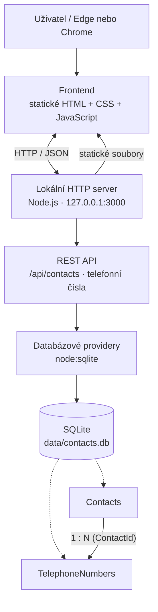

# Contacts Demo — lokální aplikace (Node.js + SQLite)

## Cíl projektu

Cílem projektu je vytvořit jednoduchou lokální webovou aplikaci pro evidenci kontaktů, která bude fungovat na Windows bez cloudové infrastruktury a bez nutnosti instalovat samostatný databázový server.

Aplikace bude postavena na třech vrstvách:

1. **Databáze — SQLite:** Data budou uložena v lokálním databázovém souboru `data/contacts.db`.
2. **Backend — Node.js:** Lokální proces Node.js bude provozovat HTTP server na konfigurovatelném portu (výchozí `3000`). Bude obsahovat databázové providery pro komunikaci se SQLite a poskytovat REST API pro práci s daty.
3. **Frontend — statické HTML, CSS a JavaScript:** Uživatelské rozhraní bude tvořit statická HTML stránka s JavaScriptem. Frontend bude komunikovat s backendem prostřednictvím HTTP požadavků na REST API. Nebude přistupovat k SQLite přímo.

### Architektura

```text
Webový prohlížeč (Edge / Chrome)
  └── Statické HTML + CSS + JavaScript
        │ HTTP / REST API
        ▼
Lokální Node.js server (127.0.0.1:3000)
  ├── Poskytování statických souborů frontendu
  ├── REST API (/api/contacts)
  └── Databázová vrstva / provideři
        │
        ▼
SQLite (data/contacts.db)
```

Aplikace bude běžet výhradně lokálně. Backend bude obsluhovat jak REST API, tak statické soubory frontendu, takže není nutný samostatný webový server ani frontendový bundler.

### Graf architektury

Následující diagram je ve formátu Mermaid a GitHub jej vykreslí přímo v README.



## Rozsah demonstrační aplikace

Cílový datový model bude obsahovat dvě tabulky:

- **Contacts** — evidence kontaktů (např. jméno a příjmení).
- **TelephoneNumbers** — telefonní čísla přiřazená ke kontaktům.

Mezi tabulkami bude vztah **1:N**: jeden kontakt může mít více telefonních čísel; každé telefonní číslo náleží právě jednomu kontaktu. Vazba bude realizována cizím klíčem `TelephoneNumbers.ContactId` na `Contacts.Id`.

Každý záznam `TelephoneNumbers` bude obsahovat:
- `Id` — primární klíč,
- `ContactId` — cizí klíč na kontakt,
- `Type` — **option set** (výběr z předdefinovaných typů telefonu): **mobil, pevná linka, fax, pracovní, jiný**,
- `PhoneNumber` — textové pole pro zadání telefonního čísla (aby se zachovalo `+`, úvodní nuly a formátování).

```text
Contacts (1)
  Id
  FirstName
  LastName
    │
    └── (N) TelephoneNumbers
              Id
              ContactId → Contacts.Id
              Type
              PhoneNumber
```

**Uživatelské rozhraní:** Přehled kontaktů a pohodlný editační formulář kontaktu. V detailu kontaktu bude možné přímo zobrazovat, přidávat, upravovat a odebírat libovolný počet telefonních čísel. U každého čísla bude výběrové pole pro typ telefonu a vstupní pole pro samotné číslo. Ovládání má být přehledné a umožňovat editaci kontaktu i jeho telefonních čísel bez zbytečného přecházení mezi stránkami.

Dosavadní demonstrační implementace eviduje jméno, příjmení a jedno telefonní číslo; výše uvedený model a editor představují **požadovaný cílový stav**, nikoli potvrzení, že už jsou implementovány.

## REST API v1 — návrh kontraktu

Základní adresa: `http://localhost:3000/api`. Komunikace probíhá přes HTTP s JSON těly požadavků a odpovědí (`Content-Type: application/json`). Identifikátory jsou v URL; pro vytvoření nového záznamu je přiděluje server.

### Kontakty (Contacts)

| Metoda | Endpoint | Význam |
| --- | --- | --- |
| `GET` | `/api/contacts` | Seznam kontaktů |
| `POST` | `/api/contacts` | Založení kontaktu |
| `PUT` | `/api/contacts/:id` | Úprava kontaktu |
| `DELETE` | `/api/contacts/:id` | Smazání kontaktu |

Příklad těla pro `POST` a `PUT`:

```json
{
  "firstName": "Jan",
  "lastName": "Novák"
}
```

### Telefonní čísla (TelephoneNumbers)

| Metoda | Endpoint | Význam |
| --- | --- | --- |
| `GET` | `/api/contacts/:contactId/telephone-numbers` | Seznam telefonních čísel daného kontaktu |
| `POST` | `/api/contacts/:contactId/telephone-numbers` | Přidání telefonního čísla ke kontaktu |
| `PUT` | `/api/contacts/:contactId/telephone-numbers/:phoneId` | Úprava konkrétního telefonního čísla |
| `DELETE` | `/api/contacts/:contactId/telephone-numbers/:phoneId` | Smazání konkrétního telefonního čísla |

Příklad těla pro `POST` a `PUT`:

```json
{
  "type": "mobile",
  "phoneNumber": "+420 777 123 456"
}
```

`type` je option set s povolenými hodnotami `mobile` (mobil), `landline` (pevná linka), `fax`, `work` (pracovní), `other` (jiný). `phoneNumber` je textový řetězec. `contactId` se bere z URL a nelze jej měnit tělem požadavku.

### Pravidla API

- `GET` vrací `200 OK` a JSON pole; prázdný seznam je `[]`.
- `POST` při úspěchu vrací `201 Created`, JSON nového záznamu včetně ID a hlavičku `Location`.
- `PUT` při úspěchu vrací `200 OK` s upraveným záznamem. `PUT` představuje úplnou aktualizaci editovatelných polí.
- `DELETE` při úspěchu vrací `204 No Content`.
- Neexistující kontakt nebo telefonní číslo: `404 Not Found`; chybné vstupy či nepovolený typ: `400 Bad Request`.
- Úprava a smazání telefonního čísla musí ověřit, že `phoneId` skutečně patří ke kontaktu `contactId`.
- Při odstranění kontaktu se odstraní i všechna jeho telefonní čísla; databázová vazba bude mít `ON DELETE CASCADE` a aktivní SQLite foreign keys (`PRAGMA foreign_keys = ON`).
- REST vrstva pouze validuje a obsluhuje HTTP; databázové operace provádí oddělená provider/repository vrstva.

**Stav:** Jde o cílový návrh kontraktu. Není tím potvrzeno, že jsou všechny endpointy již implementovány.

## Uživatelské rozhraní — cílová specifikace

### Obecný princip: metadata-driven UI

Frontend bude tvořen statickým HTML souborem (aplikační shell), CSS a JavaScriptem. **Konkrétní gridy, formuláře a jejich pole nebudou napevno napsané v HTML.** Budou deklarovány v samostatných JSON metadatech inspirovaných strukturou formulářů, pohledů a vztahů v Dynamics 365 CE / Dataverse. Univerzální JavaScript renderer tato metadata načte, vykreslí příslušné UI a napojí je na REST API. Konfigurace bude oddělená od rendereru a od databázových providerů.

### Hlavní obrazovka a navigace

- Nahoře bude hlavička / stavový řádek s logem nebo názvem aplikace **Contacts Demo**.
- Navigační menu bude obsahovat položku **Kontakty**.
- Výchozí obrazovkou bude **dashboard** s dlaždicí **Moje kontakty**.
- Pod dlaždicí bude **grid kontaktů** (seznam kontaktů), načítaný přes REST API.
- Kliknutí na řádek nebo odkaz kontaktu otevře **detail kontaktu**.
- Grid kontaktů bude obsahovat akce pro založení a smazání kontaktu; smazání bude potvrzováno vlastním dialogem.

### Formulář detailu kontaktu

- Detail kontaktu bude editovatelný formulář s poli **jméno**, **příjmení** a výhledově dalšími poli (např. **poznámky**); rozšíření datového modelu o tato pole se upřesní později.
- Formulář bude podporovat uložení změn a zrušení editace.
- Pod hlavní částí formuláře bude **subgrid telefonních čísel** navázaný vztahem Contacts 1:N TelephoneNumbers.
- Subgrid bude načítat pouze telefony otevřeného kontaktu.
- V subgridu bude tlačítko **+** pro přidání telefonu, otevření telefonu kliknutím na řádek a ikona **koše** pro jeho smazání.

### Formulář telefonního čísla

- Kliknutí na **+** otevře formulář nového telefonu.
- Kliknutí na existující řádek v subgridu otevře tentýž formulář s předvyplněnými údaji.
- Formulář obsahuje **Type** jako option set (mobil, pevná linka, fax, pracovní, jiný) a **PhoneNumber** jako textový vstup.
- Akce **Uložit** provede vytvoření nebo změnu přes REST API; **Zrušit** zavře formulář bez uložení.
- Vazba na nadřazený kontakt se předává z kontextu detailu kontaktu, nikoli jako volně editovatelné pole.

### Mazání a potvrzovací dialogy

- V gridu kontaktů i subgridu telefonů bude u záznamu ikona koše.
- Před odstraněním se otevře **vlastní modální potvrzovací formulář** s otázkou typu „Opravdu chcete smazat kontakt?“ / „Opravdu chcete smazat telefonní číslo?“ a volbami **Ano / Ne**.
- **Nepoužívat nativní `alert()` ani `confirm()`.**
- **Ano** zavolá odpovídající DELETE endpoint a po úspěchu aktualizuje grid; **Ne** dialog zavře bez změny.
- Při mazání kontaktu je vhodné upozornit, že se spolu s ním smažou i jeho telefonní čísla (kaskádové odstranění).

### Centrální CSS a odpovědnosti rendereru — závazná pravidla

- **Renderer generuje obecné HTML elementy** podle JSON metadat: např. `div`, `section`, `label`, `input`, `select`, `button`, `table` a související prvky. Řeší datové vazby, události a chování komponent, nikoliv jejich individuální vizuální styl.
- **Jediný centrální CSS soubor** (navržený název `styles.css`) řídí vzhled a rozložení celé aplikace: dashboardu, navigace, gridů, formulářů, subgridů, tlačítek, dialogů, popisků, vstupních polí i jejich stavů.
- **Styly se aplikují důsledně přes opakovaně použitelné CSS třídy**, nikoliv přes inline `style` atributy, JavaScriptové nastavování vizuálních vlastností nebo styly svázané s konkrétním ID či jedním formulářem.
- Renderer přiřazuje HTML elementům konzistentní sémantické třídy, např. `app-field`, `app-field__label`, `app-field__input`, `app-button`, `app-grid`, `app-dialog`. Varianty a stavy mohou být vyjádřeny modifikačními třídami (např. `app-button--primary`, `is-invalid`).
- **Rozložení formulářů a jejich prvků se vizuálně řídí centrálními CSS třídami.** JSON metadata určují strukturu, pořadí a seskupení komponent, zatímco CSS určuje jejich výsledné rozmístění, rozměry, odsazení a responzivní chování.
- Změna společné třídy, např. `app-field__input` nebo `app-field__label`, se musí projevit napříč všemi formuláři bez úpravy jednotlivých JSON definic nebo rendereru.
- **CSS musí být ručně čitelné a dokumentované:** každá významná třída nebo logicky související skupina tříd bude mít komentář vysvětlující účel, použití a případné varianty. Soubor bude členěný do pojmenovaných sekcí (základní proměnné, layout, navigace, formuláře, gridy, tlačítka, dialogy, stavy, responzivita).
- Pro sdílené hodnoty používat centrální CSS custom properties (`--app-...`) pro barvy, mezery, typografii a další design tokeny. Tím lze měnit jednotný vizuální styl z jednoho místa.
- **Nevytvářet další lokální CSS soubory, komponentové styly ani style bloky v HTML.** Případné nové komponenty se stylují rozšířením téhož centrálního souboru a opětovným použitím existujících tříd.

Příklad konvence:

```css
/* Design tokeny: společné hodnoty pro celou aplikaci. */
:root {
  --app-space-sm: 8px;
  --app-control-radius: 6px;
}

/* Kontejner jednoho formulářového pole: řídí rozložení popisku a vstupu. */
.app-field {
  display: flex;
  flex-direction: column;
  gap: var(--app-space-sm);
}

/* Popisek vstupního pole: jednotný vzhled všech labelů formulářů. */
.app-field__label {
  font-weight: 600;
}

/* Vstupní pole: společné okraje a zaoblení textových vstupů. */
.app-field__input {
  border-radius: var(--app-control-radius);
}
```

### JSON metadata a univerzální renderer

Metadatové definice musí podporovat minimálně:

1. **Navigaci a dashboard** — menu, dlaždice, cílové pohledy.
2. **Entity a data source/provider** — logický název entity, REST endpoint, metody GET/POST/PUT/DELETE, identifikační pole a mapování datových polí na JSON vlastnosti API.
3. **Grid (view)** — sloupce, popisky, pořadí, zdroj dat, akce pro nový záznam / otevření / smazání.
4. **Formulář (form)** — sekce, pořadí a typy polí, popisky, editovatelnost, povinná pole, tlačítka Uložit / Zrušit a mapování na API.
5. **Subgrid / vztah** — nadřazená a podřízená entita, vztah 1:N, vazební pole `ContactId`, endpoint závislý na ID otevřeného kontaktu.
6. **Option set** — stabilní hodnoty a zobrazované popisky (např. `mobile` → Mobil).
7. **Dialogy a akce** — konfigurovatelné potvrzení mazání a vazba akcí na příslušné REST operace.

Příklad **ilustrativního návrhu** metadat (finální JSON schéma se ještě upřesní):

```json
{
  "entities": {
    "contact": {
      "idField": "id",
      "provider": {
        "list": { "method": "GET", "url": "/api/contacts" },
        "create": { "method": "POST", "url": "/api/contacts" },
        "update": { "method": "PUT", "url": "/api/contacts/{id}" },
        "delete": { "method": "DELETE", "url": "/api/contacts/{id}" }
      },
      "fields": {
        "firstName": { "type": "text", "label": "Jméno" },
        "lastName": { "type": "text", "label": "Příjmení" }
      },
      "views": {
        "main": {
          "type": "grid",
          "columns": ["firstName", "lastName"],
          "openForm": "detail",
          "allowCreate": true,
          "allowDelete": true
        }
      },
      "forms": {
        "detail": {
          "fields": ["firstName", "lastName"],
          "subgrids": [
            {
              "entity": "telephoneNumber",
              "relationField": "contactId",
              "parentIdField": "id",
              "view": "byContact"
            }
          ]
        }
      }
    },
    "telephoneNumber": {
      "idField": "id",
      "provider": {
        "list": { "method": "GET", "url": "/api/contacts/{contactId}/telephone-numbers" },
        "create": { "method": "POST", "url": "/api/contacts/{contactId}/telephone-numbers" },
        "update": { "method": "PUT", "url": "/api/contacts/{contactId}/telephone-numbers/{id}" },
        "delete": { "method": "DELETE", "url": "/api/contacts/{contactId}/telephone-numbers/{id}" }
      },
      "fields": {
        "type": {
          "type": "optionset",
          "label": "Typ telefonu",
          "options": [
            { "value": "mobile", "label": "Mobil" },
            { "value": "landline", "label": "Pevná linka" },
            { "value": "fax", "label": "Fax" },
            { "value": "work", "label": "Pracovní" },
            { "value": "other", "label": "Jiný" }
          ]
        },
        "phoneNumber": { "type": "text", "label": "Telefonní číslo" }
      },
      "views": {
        "byContact": {
          "type": "grid",
          "columns": ["type", "phoneNumber"],
          "openForm": "detail",
          "allowCreate": true,
          "allowDelete": true
        }
      },
      "forms": {
        "detail": {
          "fields": ["type", "phoneNumber"],
          "actions": ["save", "cancel"]
        }
      }
    }
  },
  "navigation": [{ "label": "Kontakty", "entity": "contact", "view": "main" }],
  "dashboard": {
    "tiles": [{ "label": "Moje kontakty", "entity": "contact", "view": "main" }]
  },
  "dialogs": {
    "confirmDelete": {
      "type": "modal",
      "buttons": ["yes", "no"]
    }
  }
}
```

**Poznámka k rozsahu:** Jde o požadovanou cílovou architekturu a příklad metadat, nikoli o hotový renderer. Konkrétní názvy souborů, JSON schéma, komponenty a případná další pole kontaktu se mohou upřesnit při implementaci.

## Spuštění na Windows

Cílové prostředí: **Windows 10/11**. Vyžaduje nainstalovaný Node.js **22.13+** (doporučeno aktuální LTS) a npm. Příkazy spusť v PowerShellu nebo terminálu VS Code v kořenovém adresáři repozitáře.

```powershell
cd prdel\contacts-demo
npm install
npm start
```

Otevři v Edge nebo Chrome **http://localhost:3000**. Ukončení: Ctrl+C. SQLite databáze vznikne automaticky v `data/contacts.db`; tento soubor se necommituje.

**Neotevírej `index.html` přes file://** — frontend volá API běžící na stejném lokálním serveru. Server poslouchá jen na `127.0.0.1`, ne na celé síti.

### Jak se spouští SQLite

**SQLite se nespouští jako samostatný proces ani služba.** Jde o vestavěnou databázovou knihovnu, kterou používá přímo Node.js backend (v této aplikaci přes vestavěný modul `node:sqlite`). Není potřeba instalovat ani spouštět samostatný SQLite server.

Po spuštění `npm start`:

1. Node.js spustí backendový proces.
2. Backend při inicializaci otevře soubor `data/contacts.db`; pokud databáze ještě neexistuje, vytvoří ji.
3. Databázová vrstva používá SQLite v rámci stejného procesu Node.js. Čtení a zápisy se provádějí přímo nad lokálním databázovým souborem, nikoliv přes síťové spojení k databázovému serveru.
4. HTTP server začne naslouchat na `127.0.0.1:3000` a poskytuje frontend i REST API.

Ukončením Node.js procesu (`Ctrl+C`) skončí také práce s SQLite; data zůstávají uložená v `data/contacts.db`. Při dalším spuštění se stejný soubor znovu otevře.

## Agenti

Projekt počítá s jedním hlavním Codex orchestrátorem a čtyřmi rolemi: DB, Backend, Frontend a QA.

`AGENTS.md` je vstup pro hlavního orchestrátora, `agents/*.md` obsahují pravidla čtyř specializací. Pouhé MD soubory agenty samy nespouštějí. Codex musí mít nakonfigurovanou odpovídající podporu delegování.

## Bezpečnost a stav

Určeno pro lokální vývoj a demonstraci, bez autentizace; nevystavovat veřejně. Nejsou potřeba cloudové databáze ani přístup k osobním účtům. Projekt je připravený k experimentu; agenti zatím nebyli skutečně spuštěni. **Ve Windows a v prohlížeči zatím nebyla aplikace v tomto projektu spuštěna a otestována.**
