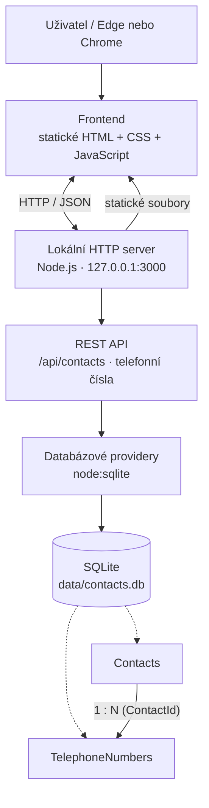

# Contacts Demo — lokální aplikace (Node.js + SQLite)

## Cíl projektu

Cílem projektu je vytvořit jednoduchou lokální webovou aplikaci pro evidenci kontaktů, která bude v první fázi fungovat lokálně na Windows i macOS bez cloudové infrastruktury a bez nutnosti instalovat samostatný databázový server.

Aplikace bude postavena na třech vrstvách:

1. **Databáze — SQLite:** Data budou uložena v lokálním databázovém souboru `data/contacts.db`.
2. **Backend — Node.js:** Lokální proces Node.js bude provozovat HTTP server na konfigurovatelném portu (výchozí `3000`). Bude obsahovat databázové providery pro komunikaci se SQLite a poskytovat REST API pro práci s daty.
3. **Frontend — statické HTML, CSS a JavaScript:** Uživatelské rozhraní bude tvořit statická HTML stránka s JavaScriptem. Frontend bude komunikovat s backendem prostřednictvím HTTP požadavků na REST API. Nebude přistupovat k SQLite přímo.

### Architektura

```text
Webový prohlížeč (Edge / Chrome)
  └── Statické HTML + CSS + JavaScript
        │ HTTP / REST API
        ▼
Lokální Node.js server (127.0.0.1:3000)
  ├── Poskytování statických souborů frontendu
  ├── REST API (/api/contacts)
  └── Databázová vrstva / provideři
        │
        ▼
SQLite (data/contacts.db)
```

V první fázi aplikace poběží výhradně lokálně. Node.js backend bude obsluhovat jak REST API, tak statické soubory frontendu, takže není nutný samostatný webový server ani frontendový bundler.

### Graf architektury

Následující diagram je ve formátu Mermaid a GitHub jej vykreslí přímo v README.



### Přenositelnost a varianty nasazení backendu

**Závazný princip:** frontend (statické HTML, univerzální JavaScript renderer, JSON metadata, centrální CSS) komunikuje výhradně přes stabilní REST API v1. Nesmí záviset na jazyce nebo technologii, ve které je backend implementován. Backend lze vyměnit bez změn definic formulářů a gridů.

| Cílové prostředí | Implementace REST backendu | Databáze | Stav |
| --- | --- | --- | --- |
| Lokální Windows a macOS | Node.js | SQLite | První implementace |
| Windows Server / IIS | ASP.NET Core v C# | SQLite | Budoucí portace |
| Apache / běžný PHP webhosting | PHP | SQLite | Budoucí portace |

**Prozatím používáme SQLite ve všech variantách.** Podpora SQL Server Express a MariaDB není součástí aktuálního rozsahu; případné další databázové providery se navrhnou až později. Oddělení databázové vrstvy od HTTP controllerů má budoucí rozšíření usnadnit, ale samo o sobě neznamená, že bude bez práce.

Pravidla přenositelnosti:

- Všechny backendy implementují stejná REST URL, HTTP metody, JSON názvy polí, option sety, validace, návratové kódy a chybové odpovědi. Kontrakt REST API v1 je nezávislý na implementaci.
- Backend má oddělenou HTTP/API vrstvu, aplikační logiku a SQLite repository/provider vrstvu. Při portaci z Node.js do C# nebo PHP se backendová implementace přepíše v příslušném jazyce, frontend se zachová.
- Base URL API je konfigurovatelná; metadata neobsahují pevně zadaný host nebo port. Výchozí relativní prefix je `/api`.
- Databázové schéma SQLite, datové typy a migrace budou verzované a společné pro všechny implementace; je nutné zohlednit rozdíly v přístupových knihovnách.
- Nasazení na IIS a Apache není automaticky spuštění původního Node.js procesu: na IIS se počítá s ASP.NET Core, na PHP hostingu s PHP.
- U webhostingu je potřeba předem ověřit dostupnost SQLite rozšíření (PHP PDO SQLite), zapisovatelný prostor pro databázi a omezení hostingu. Soubor SQLite musí být **mimo veřejně dostupný webový adresář** a chráněný před stažením přes HTTP.
- Veřejné nasazení bude vyžadovat doplnění autentizace, autorizace, HTTPS a provozních bezpečnostních opatření; současná lokální demonstrace je nemá.

## Rozsah demonstrační aplikace

Datový model v1 je **schválený** a jeho jediným závazným popisem je [DATOVY_MODEL.md](docs/DATOVY_MODEL.md).

- **Contacts:** `Id` (GUID), `FirstName`, `LastName`, `Address`, `Description`.
- **TelephoneNumbers:** `Id` (GUID), `ContactId` (GUID, FK), `Type`, `PhoneNumber`, `Description`.
- Vazba **Contacts 1:N TelephoneNumbers**; při smazání kontaktu se jeho telefony odstraní kaskádově.
- Typ telefonu: `mobile`, `landline`, `fax`, `work`, `other`.

Detail kontaktu umožní spravovat libovolný počet telefonů v subgridu. Aktuální `server.js` je starý prototyp s jednou tabulkou a číselným ID; **není implementací schváleného modelu**.

## REST API v1 — schválený kontrakt

Jediným závazným kontraktem je [API.md](docs/API.md). Obsahuje **pět CRUD operací pro každou entitu** (celkem 10 endpointů):

| Operace | Contacts | TelephoneNumbers |
| --- | --- | --- |
| Seznam | `GET /api/contacts` | `GET /api/telephones` |
| Detail | `GET /api/contacts/{id}` | `GET /api/telephones/{id}` |
| Vytvoření | `POST /api/contacts` | `POST /api/telephones` |
| Aktualizace | `PUT /api/contacts/{id}` | `PUT /api/telephones/{id}` |
| Smazání | `DELETE /api/contacts/{id}` | `DELETE /api/telephones/{id}` |

Pro subgrid: `GET /api/telephones?contactId={guid}`. Všechny identifikátory jsou GUID řetězce; `id` vytváří backend. Staré vnořené endpointy `/api/contacts/{contactId}/telephone-numbers` se **nepoužívají**. Backend Node.js je první implementace; ASP.NET Core a PHP mají později implementovat totožný kontrakt.

## Uživatelské rozhraní — cílová specifikace

### Obecný princip: metadata-driven UI

Frontend bude tvořen statickým HTML souborem (aplikační shell), CSS a JavaScriptem. **Konkrétní gridy, formuláře a jejich pole nebudou napevno napsané v HTML.** Budou deklarovány v samostatných JSON metadatech inspirovaných strukturou formulářů, pohledů a vztahů v Dynamics 365 CE / Dataverse. Univerzální JavaScript renderer tato metadata načte, vykreslí příslušné UI a napojí je na REST API. Konfigurace bude oddělená od rendereru a od databázových providerů.

### Hlavní obrazovka a navigace

- Nahoře bude hlavička / stavový řádek s logem nebo názvem aplikace **Contacts Demo**.
- Navigační menu bude obsahovat položku **Kontakty**.
- Výchozí obrazovkou bude **dashboard** s dlaždicí **Moje kontakty**.
- Pod dlaždicí bude **grid kontaktů** (seznam kontaktů), načítaný přes REST API.
- Kliknutí na řádek nebo odkaz kontaktu otevře **detail kontaktu**.
- Grid kontaktů bude obsahovat akce pro založení a smazání kontaktu; smazání bude potvrzováno vlastním dialogem.

### Formulář detailu kontaktu

- Detail kontaktu bude editovatelný formulář s poli **jméno**, **příjmení**, **adresu** a **popis** podle schváleného datového modelu.
- Formulář bude podporovat uložení změn a zrušení editace.
- Pod hlavní částí formuláře bude **subgrid telefonních čísel** navázaný vztahem Contacts 1:N TelephoneNumbers.
- Subgrid bude načítat pouze telefony otevřeného kontaktu.
- V subgridu bude tlačítko **+** pro přidání telefonu, otevření telefonu kliknutím na řádek a ikona **koše** pro jeho smazání.

### Formulář telefonního čísla

- Kliknutí na **+** otevře formulář nového telefonu.
- Kliknutí na existující řádek v subgridu otevře tentýž formulář s předvyplněnými údaji.
- Formulář obsahuje **Type** jako option set (mobil, pevná linka, fax, pracovní, jiný), **PhoneNumber** jako textový vstup a **Description** jako víceřádkový popis.
- Akce **Uložit** provede vytvoření nebo změnu přes REST API; **Zrušit** zavře formulář bez uložení.
- Vazba na nadřazený kontakt se předává z kontextu detailu kontaktu, nikoli jako volně editovatelné pole.

### Mazání a potvrzovací dialogy

- V gridu kontaktů i subgridu telefonů bude u záznamu ikona koše.
- Před odstraněním se otevře **vlastní modální potvrzovací formulář** s otázkou typu „Opravdu chcete smazat kontakt?“ / „Opravdu chcete smazat telefonní číslo?“ a volbami **Ano / Ne**.
- **Nepoužívat nativní `alert()` ani `confirm()`.**
- **Ano** zavolá odpovídající DELETE endpoint a po úspěchu aktualizuje grid; **Ne** dialog zavře bez změny.
- Při mazání kontaktu je vhodné upozornit, že se spolu s ním smažou i jeho telefonní čísla (kaskádové odstranění).

### Centrální CSS a odpovědnosti rendereru — závazná pravidla

- **Renderer generuje obecné HTML elementy** podle JSON metadat: např. `div`, `section`, `label`, `input`, `select`, `button`, `table` a související prvky. Řeší datové vazby, události a chování komponent, nikoliv jejich individuální vizuální styl.
- **Jediný centrální CSS soubor** (navržený název `styles.css`) řídí vzhled a rozložení celé aplikace: dashboardu, navigace, gridů, formulářů, subgridů, tlačítek, dialogů, popisků, vstupních polí i jejich stavů.
- **Styly se aplikují důsledně přes opakovaně použitelné CSS třídy**, nikoliv přes inline `style` atributy, JavaScriptové nastavování vizuálních vlastností nebo styly svázané s konkrétním ID či jedním formulářem.
- Renderer přiřazuje HTML elementům konzistentní sémantické třídy, např. `app-field`, `app-field__label`, `app-field__input`, `app-button`, `app-grid`, `app-dialog`. Varianty a stavy mohou být vyjádřeny modifikačními třídami (např. `app-button--primary`, `is-invalid`).
- **Rozložení formulářů a jejich prvků se vizuálně řídí centrálními CSS třídami.** JSON metadata určují strukturu, pořadí a seskupení komponent, zatímco CSS určuje jejich výsledné rozmístění, rozměry, odsazení a responzivní chování.
- Změna společné třídy, např. `app-field__input` nebo `app-field__label`, se musí projevit napříč všemi formuláři bez úpravy jednotlivých JSON definic nebo rendereru.
- **CSS musí být ručně čitelné a dokumentované:** každá významná třída nebo logicky související skupina tříd bude mít komentář vysvětlující účel, použití a případné varianty. Soubor bude členěný do pojmenovaných sekcí (základní proměnné, layout, navigace, formuláře, gridy, tlačítka, dialogy, stavy, responzivita).
- Pro sdílené hodnoty používat centrální CSS custom properties (`--app-...`) pro barvy, mezery, typografii a další design tokeny. Tím lze měnit jednotný vizuální styl z jednoho místa.
- **Nevytvářet další lokální CSS soubory, komponentové styly ani style bloky v HTML.** Případné nové komponenty se stylují rozšířením téhož centrálního souboru a opětovným použitím existujících tříd.

Příklad konvence:

```css
/* Design tokeny: společné hodnoty pro celou aplikaci. */
:root {
  --app-space-sm: 8px;
  --app-control-radius: 6px;
}

/* Kontejner jednoho formulářového pole: řídí rozložení popisku a vstupu. */
.app-field {
  display: flex;
  flex-direction: column;
  gap: var(--app-space-sm);
}

/* Popisek vstupního pole: jednotný vzhled všech labelů formulářů. */
.app-field__label {
  font-weight: 600;
}

/* Vstupní pole: společné okraje a zaoblení textových vstupů. */
.app-field__input {
  border-radius: var(--app-control-radius);
}
```

### JSON metadata a univerzální renderer

Metadatové definice musí podporovat minimálně:

1. **Navigaci a dashboard** — menu, dlaždice, cílové pohledy.
2. **Entity a data source/provider** — logický název entity, REST endpoint, metody GET/POST/PUT/DELETE, identifikační pole a mapování datových polí na JSON vlastnosti API.
3. **Grid (view)** — sloupce, popisky, pořadí, zdroj dat, akce pro nový záznam / otevření / smazání.
4. **Formulář (form)** — sekce, pořadí a typy polí, popisky, editovatelnost, povinná pole, tlačítka Uložit / Zrušit a mapování na API.
5. **Subgrid / vztah** — nadřazená a podřízená entita, vztah 1:N, vazební pole `ContactId`, seznamový endpoint `GET /api/telephones?contactId={guid}`.
6. **Option set** — stabilní hodnoty a zobrazované popisky (např. `mobile` → Mobil).
7. **Dialogy a akce** — konfigurovatelné potvrzení mazání a vazba akcí na příslušné REST operace.

Příklad **ilustrativního návrhu** metadat (finální JSON schéma rendereru se ještě musí schválit):

```json
{
  "entities": {
    "contact": {
      "idField": "id",
      "provider": {
        "list": { "method": "GET", "url": "/api/contacts" },
        "get": { "method": "GET", "url": "/api/contacts/{id}" },
        "create": { "method": "POST", "url": "/api/contacts" },
        "update": { "method": "PUT", "url": "/api/contacts/{id}" },
        "delete": { "method": "DELETE", "url": "/api/contacts/{id}" }
      },
      "fields": {
        "firstName": { "type": "text", "label": "Jméno", "required": true },
        "lastName": { "type": "text", "label": "Příjmení", "required": true },
        "address": { "type": "textarea", "label": "Adresa" },
        "description": { "type": "textarea", "label": "Popis" }
      },
      "views": {
        "main": { "type": "grid", "columns": ["firstName", "lastName"], "openForm": "detail", "allowCreate": true, "allowDelete": true }
      },
      "forms": {
        "detail": {
          "fields": ["firstName", "lastName", "address", "description"],
          "subgrids": [{ "entity": "telephoneNumber", "relationField": "contactId", "parentIdField": "id", "view": "byContact" }],
          "actions": ["save", "cancel"]
        }
      }
    },
    "telephoneNumber": {
      "idField": "id",
      "provider": {
        "list": { "method": "GET", "url": "/api/telephones" },
        "get": { "method": "GET", "url": "/api/telephones/{id}" },
        "create": { "method": "POST", "url": "/api/telephones" },
        "update": { "method": "PUT", "url": "/api/telephones/{id}" },
        "delete": { "method": "DELETE", "url": "/api/telephones/{id}" }
      },
      "filter": { "contactId": "{parent.id}" },
      "fields": {
        "type": {
          "type": "optionset",
          "label": "Typ telefonu",
          "required": true,
          "options": [
            { "value": "mobile", "label": "Mobil" },
            { "value": "landline", "label": "Pevná linka" },
            { "value": "fax", "label": "Fax" },
            { "value": "work", "label": "Telefon do práce" },
            { "value": "other", "label": "Jiný" }
          ]
        },
        "phoneNumber": { "type": "text", "label": "Telefonní číslo", "required": true },
        "description": { "type": "textarea", "label": "Popis" }
      },
      "views": {
        "byContact": { "type": "grid", "columns": ["type", "phoneNumber", "description"], "openForm": "detail", "allowCreate": true, "allowDelete": true }
      },
      "forms": {
        "detail": { "fields": ["type", "phoneNumber", "description"], "actions": ["save", "cancel"] }
      }
    }
  },
  "navigation": [{ "label": "Kontakty", "entity": "contact", "view": "main" }],
  "dashboard": { "tiles": [{ "label": "Moje kontakty", "entity": "contact", "view": "main" }] },
  "dialogs": { "confirmDelete": { "type": "modal", "buttons": ["yes", "no"] } }
}
```

**Důležité:** Ukázka ilustruje aktuální pole a API, ale konkrétní schema, vazby, validace a chování univerzálního rendereru zatím **nejsou finálně uzavřeny**.

## Spuštění na Windows

Cílové prostředí: **Windows 10/11**. Vyžaduje nainstalovaný Node.js **22.13+** (doporučeno aktuální LTS) a npm. Příkazy spusť v PowerShellu nebo terminálu VS Code v kořenovém adresáři repozitáře.

```powershell
cd prdel\contacts-demo
npm install
npm start
```

Otevři v Edge nebo Chrome **http://localhost:3000**. Ukončení: Ctrl+C. SQLite databáze vznikne automaticky v `data/contacts.db`; tento soubor se necommituje.

**Neotevírej `index.html` přes file://** — frontend volá API běžící na stejném lokálním serveru. Server poslouchá jen na `127.0.0.1`, ne na celé síti.

### Jak se spouští SQLite

**SQLite se nespouští jako samostatný proces ani služba.** Jde o vestavěnou databázovou knihovnu, kterou používá přímo Node.js backend (v této aplikaci přes vestavěný modul `node:sqlite`). Není potřeba instalovat ani spouštět samostatný SQLite server.

Po spuštění `npm start`:

1. Node.js spustí backendový proces.
2. Backend při inicializaci otevře soubor `data/contacts.db`; pokud databáze ještě neexistuje, vytvoří ji.
3. Databázová vrstva používá SQLite v rámci stejného procesu Node.js. Čtení a zápisy se provádějí přímo nad lokálním databázovým souborem, nikoliv přes síťové spojení k databázovému serveru.
4. HTTP server začne naslouchat na `127.0.0.1:3000` a poskytuje frontend i REST API.

Ukončením Node.js procesu (`Ctrl+C`) skončí také práce s SQLite; data zůstávají uložená v `data/contacts.db`. Při dalším spuštění se stejný soubor znovu otevře.

## Vývojový režim — jeden agent

První fázi projektu vyvíjí **jeden univerzální AI agent**, bez multiagentní orchestrace a bez delegování na DB/Backend/Frontend/QA podagenty. Zadání lze diktovat ChatGPT, který může přímo upravovat dokumentaci a zdrojové soubory na GitHubu; později lze použít lokální Codex CLI se stejným repozitářem a pravidly v `AGENTS.md`.

Historické instrukce v `agents/*.md` nejsou aktivní. Jeden agent řeší databázi, REST API, metadata-driven frontend i testování postupně. Závazné kontrakty jsou `docs/DATOVY_MODEL.md` a `docs/API.md`. Binární dokumentace se ukládá na Google Drive do `Context Demo/Dokumentace/Návrh`.

## Dokumentace, historie a vizuální návrh

- [Datový model](docs/DATOVY_MODEL.md) — závazný popis entit, GUID a vztahů.
- [REST API](docs/API.md) — závazný popis všech 10 CRUD operací.
- [Architektura](docs/ARCHITECTURE.md) — technologické vrstvy, lokální provoz a plánované portace.
- [DEPLOY.md](DEPLOY.md) — budoucí automatizované nahrávání na PHP webhosting přes FTP/FTPS/SFTP.
- [AGENTS.md](AGENTS.md) — instrukce pro jediného vývojového agenta.
- [HISTORIE.md](HISTORIE.md) — průběžný záznam konverzace, nikoliv specifikace; starší úseky mohou být neúplné.
- [Vizuální návrh na Google Drive](https://drive.google.com/file/d/1FvGysQqN-sKrESdDGvFKG7z_yl88OXBp/view) — uložený v `Context Demo/Dokumentace/Návrh`. Název složky Drive se liší od názvu aplikace `Contacts Demo`; jde o aktuální existující umístění.

## Bezpečnost a stav

Určeno pro lokální vývoj a demonstraci, bez autentizace; nevystavovat veřejně. Nejsou potřeba cloudové databáze ani přístup k osobním účtům. Projekt je ve fázi finalizace zadání; jednoagentní vývoj podle nových kontraktů zatím nebyl proveden. **Ve Windows a v prohlížeči zatím nebyla aplikace v tomto projektu spuštěna a otestována.**
