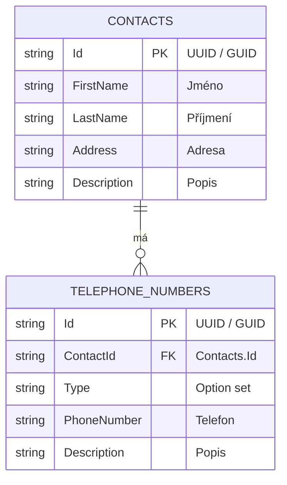

# Datový model — Contacts Demo

**Stav:** schválené funkční zadání datového modelu (v1).  
**Databáze první implementace:** SQLite.  
**Budoucí přenositelnost:** model a GUID identifikátory jsou navrženy tak, aby šly mapovat také do Dataverse a jiných databázových prostředí.

## Entity a vztahy

Model obsahuje právě dvě entity:

- **Kontakt** — technický název tabulky `Contacts`.
- **Telefon** — technický název tabulky `TelephoneNumbers`.

Jeden kontakt může mít **0 až N telefonních záznamů**. Každý telefonní záznam musí patřit **právě jednomu kontaktu**.

## 1. Kontakt (`Contacts`)

| Sloupec | Datový typ SQLite | Povinný | Význam |
| --- | --- | --- | --- |
| `Id` | `TEXT` (UUID/GUID) | Ano | Primární klíč |
| `FirstName` | `TEXT` | Ano | Jméno |
| `LastName` | `TEXT` | Ano | Příjmení |
| `Address` | `TEXT` | Ne | Adresa, v první verzi jako jedno textové pole |
| `Description` | `TEXT` | Ne | Volný popis nebo poznámka |

## 2. Telefon (`TelephoneNumbers`)

| Sloupec | Datový typ SQLite | Povinný | Význam |
| --- | --- | --- | --- |
| `Id` | `TEXT` (UUID/GUID) | Ano | Primární klíč |
| `ContactId` | `TEXT` (UUID/GUID) | Ano | Cizí klíč na `Contacts.Id` |
| `Type` | `TEXT` | Ano | Typ telefonního spojení (option set) |
| `PhoneNumber` | `TEXT` | Ano | Telefonní číslo, text kvůli `+`, nulám a formátování |
| `Description` | `TEXT` | Ne | Volný popis telefonu |

### Option set `TelephoneNumbers.Type`

| Uložená hodnota | Český popisek |
| --- | --- |
| `mobile` | Mobil |
| `landline` | Pevná linka |
| `fax` | Fax |
| `work` | Telefon do práce |
| `other` | Jiný |

Option set ukládá **stabilní strojové hodnoty**, nikoliv lokalizované české popisky. Hodnoty lze později rozšířit bez změny principu rendereru.

## Mermaid ER diagram



## Pravidla integrity a identifikátorů

1. Primární klíče obou entit jsou **GUID/UUID**, nikoliv číselné auto-increment identifikátory.
2. Pro interoperabilitu používat UUID ve standardním textovém formátu `xxxxxxxx-xxxx-xxxx-xxxx-xxxxxxxxxxxx`, malá písmena, bez složených závorek; generovat nové identifikátory jako **UUID v4**. SQLite je ukládá jako `TEXT`, v API jsou to řetězce; při případné portaci do Dataverse lze mapovat na GUID.
3. Nové `Id` přiděluje backend při vytvoření záznamu. `ContactId` telefonu se při vytvoření předává v JSON těle požadavku `POST /api/telephones` (podle aktuálního [API kontraktu](API.md)); v UI se automaticky vyplní z otevřeného kontaktu. Po vytvoření není volně editovatelný.
4. `TelephoneNumbers.ContactId` je povinný cizí klíč na `Contacts.Id`, s indexem pro rychlé načtení subgridu.
5. Při smazání kontaktu se odstraní jeho telefony: `ON DELETE CASCADE`. V SQLite zapnout `PRAGMA foreign_keys = ON` pro každé databázové připojení.
6. Jeden kontakt může mít více telefonů stejného typu; duplicity čísel nejsou na databázové úrovni zakázány.
7. `Type` musí obsahovat jednu z hodnot option setu; `PhoneNumber`, `FirstName` a `LastName` nesmí být prázdné po oříznutí mezer. Nepovinné texty mohou být `NULL`.
8. Konkrétní maximální délky textů a pravidla normalizace telefonních čísel budou součástí validace API; telefonní číslo zůstává textem, nikoliv numerickou hodnotou.

## Referenční SQLite DDL

```sql
PRAGMA foreign_keys = ON;

CREATE TABLE IF NOT EXISTS Contacts (
    Id          TEXT NOT NULL PRIMARY KEY,
    FirstName   TEXT NOT NULL CHECK (length(trim(FirstName)) > 0),
    LastName    TEXT NOT NULL CHECK (length(trim(LastName)) > 0),
    Address     TEXT,
    Description TEXT
);

CREATE TABLE IF NOT EXISTS TelephoneNumbers (
    Id          TEXT NOT NULL PRIMARY KEY,
    ContactId   TEXT NOT NULL,
    Type        TEXT NOT NULL CHECK (Type IN ('mobile', 'landline', 'fax', 'work', 'other')),
    PhoneNumber TEXT NOT NULL CHECK (length(trim(PhoneNumber)) > 0),
    Description TEXT,
    FOREIGN KEY (ContactId) REFERENCES Contacts(Id) ON DELETE CASCADE
);

CREATE INDEX IF NOT EXISTS IX_TelephoneNumbers_ContactId
    ON TelephoneNumbers(ContactId);
```

## Dopad na REST API a metadata UI

- JSON pole kontaktu: `id`, `firstName`, `lastName`, `address`, `description`.
- JSON pole telefonu: `id`, `contactId`, `type`, `phoneNumber`, `description`.
- Všechna `id` a `contactId` jsou GUID řetězce.
- Metadata rendereru musí pro oba formuláře zobrazit `Description` jako víceřádkové textové pole; `Address` může být také víceřádkové.
- Detail kontaktu obsahuje subgrid `TelephoneNumbers` filtrovaný přes `ContactId`.
- Tento dokument je zdrojem pravdy pro datový model; dřívější příklady v README, které uvádějí méně polí, jsou pouze ilustrativní a musí být při implementaci aktualizovány.

**Mimo rozsah v1:** samostatné entity adres, e-mailů, kategorií a další vztahy.
